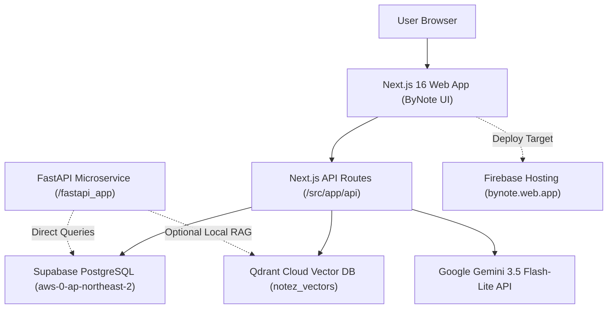

# ByNote (formerly NoteZ)

<p align="center">
  
  <br>
  <em>A thoughtful, distraction-free workspace for your notes, voice memos, and ideas. Write clearly, stay organized, and think alongside AI.</em>
</p>

<p align="center">
  <a href="#-architecture-overview">Architecture</a> •
  <a href="#-features">Features</a> •
  <a href="#-tech-stack">Tech Stack</a> •
  <a href="#-quick-start">Quick Start</a> •
  <a href="#-cloud-services--secrets">Cloud Services</a> •
  <a href="#-firebase-hosting--deployment">Deployment</a> •
  <a href="#-repository-structure">Directory Structure</a>
</p>

---

## 🏗️ Architecture Overview

ByNote combines an authenticated, interactive block editor frontend (Next.js 16 + React 19) with a resilient dual-database vector engine:



---

## ✨ Features

- **Block-Based Document Canvas**:
  - Headings (H1, H2, H3), paragraphs, to-do checklists, quote callouts, code blocks with syntax highlighting, and interactive table grids.
  - Floating inline format toolbar (bold, italic, strikethrough, code, links).
  - Quick slash command menu (`/` trigger) for fast block insertion and formatting.
- **ByNote AI & RAG Search**:
  - Intelligent context-aware workspace assistant powered by Google Gemini.
  - Dense semantic vector search with cosine similarity via Qdrant Cloud (`notez_vectors`).
  - Strict confidentiality filters to automatically prevent private documents from entering AI retrieval windows.
- **Voice Studio**:
  - High-fidelity chunked audio recording with real-time feedback.
  - Multi-speaker transcript generation and automated synthesis into executive summaries, key decisions, and follow-up tasks.
- **Dual Vector Architecture**:
  - Automatically queries Qdrant Cloud when available.
  - Transparent in-memory / relational fallback if external vector endpoints are unreachable.
- **Adaptive Visual Theme**:
  - Handcrafted modern UI with custom electric blue/violet accent palette (`#4f2bfb`).
  - Flawless contrast across dark and light modes with system auto-detection and persistence.

---

## 💻 Tech Stack

| Layer | Technologies |
| :--- | :--- |
| **Frontend Framework** | [Next.js 16](https://nextjs.org/) (App Router), [React 19](https://react.dev/) |
| **Styling & Icons** | [Tailwind CSS 4](https://tailwindcss.com/), [Lucide React](https://lucide.dev/) |
| **Primary Relational DB** | [Supabase](https://supabase.com/) PostgreSQL via [Drizzle ORM](https://orm.drizzle.team/) & `pg` connection pooler |
| **Vector Engine** | [Qdrant Cloud](https://qdrant.tech/) REST API & `@qdrant/js-client-rest` |
| **Artificial Intelligence**| [Google Gemini API](https://aistudio.google.com/) (`gemini-3.5-flash-lite`) |
| **Microservice Bridge** | [FastAPI](https://fastapi.tiangolo.com/) (Python 3.11), Uvicorn, psycopg2 |
| **Hosting & CI/CD** | [Firebase Hosting](https://firebase.google.com/) (`bynote.web.app`), GitHub Actions |

---

## ⚡ Quick Start

### 1. Clone & Install Dependencies
```bash
git clone https://github.com/ShanMade/NoteZ.git
cd NoteZ
npm install
```

### 2. Configure Environment Variables
Copy `.env.example` to `.env`:
```bash
cp .env.example .env
```
Populate `.env` with your Supabase pooler URL, Qdrant Cloud URL/Key, and Gemini API key.

### 3. Run Schema Migrations
```bash
npx drizzle-kit push
```

### 4. Start Development Server
```bash
npm run dev
```
Open [http://localhost:3000](http://localhost:3000) in your browser.

---

## 🔐 Cloud Services & Secrets

> [!IMPORTANT]
> Never commit `.env` or secret keys to version control. Set them as repository secrets in GitHub and in your hosting dashboard.

### Required Environment Variables

| Variable | Target | Purpose |
| :--- | :--- | :--- |
| `DATABASE_URL` | Server | Supabase PostgreSQL Connection Pooler URL with SSL enabled (`sslmode=require`) |
| `GEMINI_API_KEY` | Server | Google Gemini API Key for assistant completions and voice transcription |
| `GEMINI_MODEL` | Server | Gemini model identifier (default: `gemini-3.5-flash-lite`) |
| `QDRANT_URL` | Server | Qdrant Cloud cluster endpoint |
| `QDRANT_API_KEY` | Server | Qdrant Cloud API token |
| `NEXT_PUBLIC_FIREBASE_*` | Client | Firebase client SDK parameters for project `ai-notez` |

---

## 🚀 Vercel Services deployment

The root `vercel.json` deploys the Next.js `app` and two FastAPI services, `backend` and `fastapi_app`. All public paths, including `/api/*`, go to Next.js; those API routes already implement the application's backend. The two Python services currently contain identical bridge implementations, are private, and are not called by the application. There are no service bindings because there are no service-to-service calls. In particular, the `FASTAPI_URL` in Docker Compose is not used by the Next.js code. Do not expose the Python endpoints without adding appropriate authentication and deciding which implementation to use.

Configure the environment variables above in the Vercel project for the appropriate environments. PostgreSQL and Qdrant are external dependencies, not Vercel services: use reachable hosted URLs instead of the local or Docker hostnames in the example files. Run the database migrations separately against the target database. Firebase client variables must also be present at build time.

For local integration testing, install the Vercel CLI, link the project, configure its development environment and run `vercel dev` from the repository root. It runs the services together; a plain `npm run dev` only runs Next.js. Vercel bindings, if added later, are injected at runtime into the calling service's functions, not during builds or in middleware; do not manually set their injected URL variables.

### GitHub Actions deployment

The workflow `.github/workflows/vercel-deploy.yml` deploys production on pushes to `main`. In GitHub, open **Settings → Secrets and variables → Actions → Repository secrets** and add:

- `VERCEL_TOKEN`: a Vercel access token with access to the project and its team. Create one in your Vercel account settings; never commit it or share it in chat.
- `VERCEL_ORG_ID` and `VERCEL_PROJECT_ID`: the organization/team ID and project ID for that Vercel project. To find them, run `vercel link` locally and inspect the generated `.vercel/project.json` (`orgId` and `projectId`); keep that directory untracked.

These are GitHub Actions secrets, separate from the application's environment variables configured in Vercel. Repository secrets (or organization secrets available to this repository) are needed: the workflow does not select a GitHub deployment environment. After setting them, re-run the failed workflow in the GitHub Actions tab or push a new commit to `main`. An invalid token or IDs without access to the project will still prevent deployment.

## 🚀 Firebase Hosting & Deployment

The application is configured to deploy to Firebase Hosting targeting `bynote.web.app`.

### Deploy using Firebase CLI
```bash
# Log in to Firebase
firebase login

# Set target for bynote hosting site
firebase target:apply hosting bynote bynote

# Deploy hosting
firebase deploy --only hosting:bynote
```

### Automated GitHub Actions CI/CD
On every push to `main`, `.github/workflows/firebase-hosting.yml` automatically triggers, builds the Next.js application with GitHub Secrets, and publishes directly to Firebase live channel.

---

## 📂 Repository Structure

Below is an overview of the core directories in this repository. Each folder contains its own dedicated `README.md` explaining internal architecture and guidelines:

```
├── .github/workflows/      # Automated CI/CD deployment pipelines
├── drizzle/                # Drizzle ORM SQL migration snapshots & journal
├── fastapi_app/            # FastAPI Python microservice for vector embeddings & RAG
├── public/                 # Static assets, ByNote logos, icons, and favicons
└── src/
    ├── app/                # Next.js App Router (pages, layouts, and REST APIs)
    │   └── api/            # Serverless API routes (auth, documents, assistant, voice)
    ├── components/         # Modular React UI components (editor, sidebar, modal dialogs)
    ├── db/                 # Database connection pooler & Drizzle schema definitions
    ├── hooks/              # Custom React hooks (keyboard shortcuts, focus management)
    ├── lib/                # Core utilities (Gemini client, Qdrant client, auth, markdown)
    └── types/              # TypeScript interfaces for blocks, documents, and AI payloads
```
